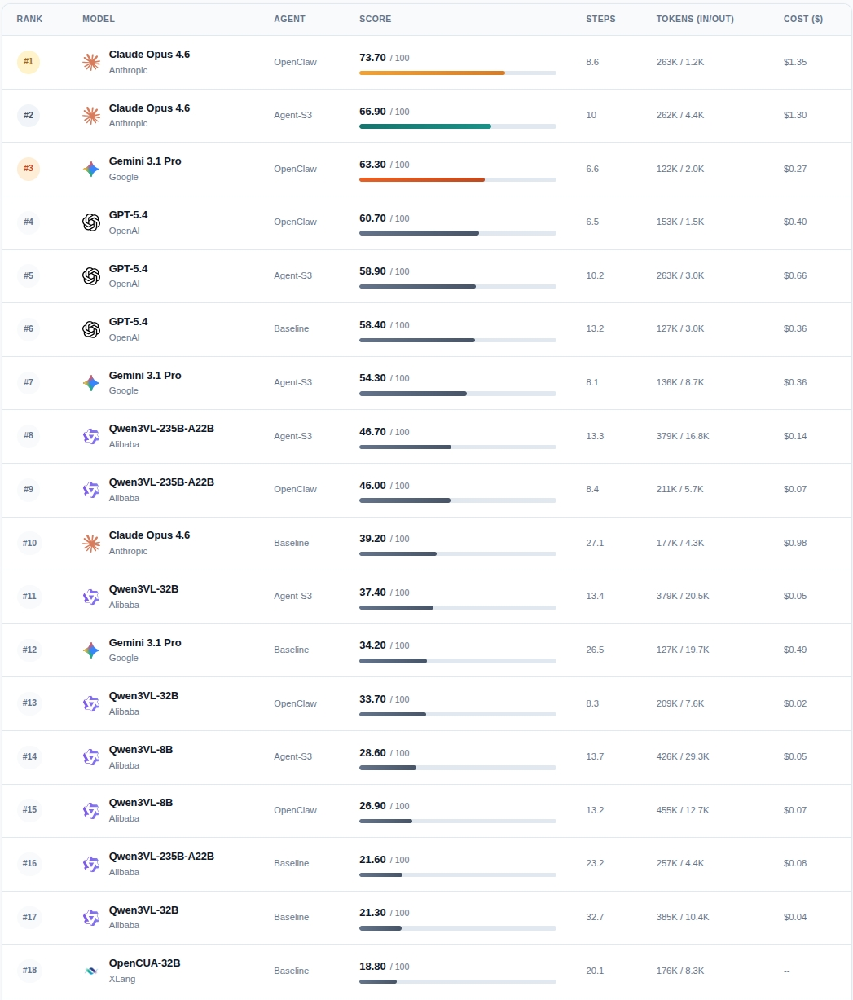
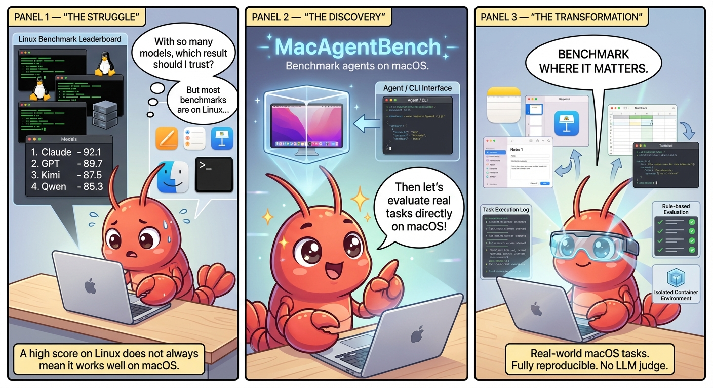
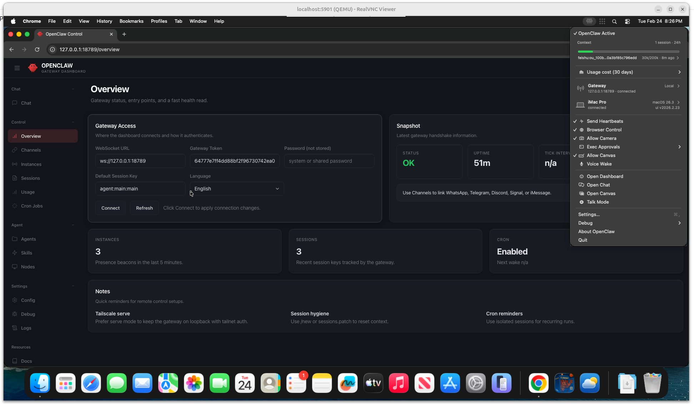

<h1 align="center">&nbsp; MacAgentBench: Benchmarking AI Agents on Real-World macOS Desktop</h1>

<p align="center">
  <strong>A comprehensive macOS benchmark for evaluating computer use agents.<br>
676 tasks across 25 applications, deterministic rule-based evaluation,<br>
fine-grained multi-checkpoint scoring, and support for 3 agent frameworks.</strong><br>
</p>

<p align="center">
  <a href="https://jetastra.github.io/MacAgentBench/"></a>
  <a href="#quick-start"></a>
  <a href="#benchmark-overview"></a>
  
  
  <a href="LICENSE"></a>
</p>

<!-- leaderboard:start -->
## 🏆 Live Leaderboard Snapshot

<p align="center">
  <a href="https://jetastra.github.io/MacAgentBench/">
    
  </a>
</p>

<p align="center">
  <a href="https://jetastra.github.io/MacAgentBench/"><strong>See the full live leaderboard →</strong></a>
</p>
<!-- leaderboard:end -->

<p align="center">
  
</p>

---

## 🔎 Overview

**MacAgentBench** is a comprehensive macOS agent benchmark with:

- **676 tasks** across **25** applications
- **Deterministic rule-based evaluation** with fine-grained multi-checkpoint scoring
- **3 agent frameworks** (Baseline, Agent-S3, OpenClaw) and **16+ models** evaluated
- **Containerized execution** — each task runs in an independent Docker container

## 📊 Key Results

| Framework | Best Model | Pass@1 |
|-----------|-----------|--------|
| OpenClaw | Claude Opus 4.6 | **73.7%** |
| Agent-S3 | Claude Opus 4.6 | 66.9% |
| Baseline | Claude Opus 4.6 | 39.2% |

<a id="quick-start"></a>

## 🚀 Quick Start

### 1. Set Up the Environment

Download the macOS VM image (~50GB):

```bash
pip install huggingface_hub
huggingface-cli download JetLM/OpenClaw-macOS --local-dir .
```

Install dependencies:

```bash
pip install -r requirements.txt
```

Start the macOS Docker container:

```bash
bash launcher/docker/simple_start.sh
```

Connect via VNC:

```bash
vncviewer localhost:5901
```

<p align="center">
  
</p>

### 2. Run Evaluation

1. Configure your model API in `run_example.sh`
2. Run:

```bash
bash run_example.sh
```

For specific models with parallel dispatch, see scripts in `scripts/run_*.sh`.

### Supported Model Types

| Model Type | Examples |
|-----------|---------|
| `gpt` | GPT-5.4, Gemini 3.1 Pro |
| `claude` | Claude Opus 4.6 |
| `qwen3vl` | Qwen3-VL-8B/32B |
| `InternVL` | InternVL3.5-8B/14B |
| `scalecua` | ScaleCUA-7B/32B |
| `uitars` | UI-TARS-7B/72B |
| `guiowl` | GUI-Owl-1.5-8B/32B |
| `OpenCUA` | OpenCUA-7B/32B |
| `openclaw` | Any model via OpenClaw framework |

<a id="benchmark-overview"></a>

## 📁 Project Structure

```
MacAgentBench/
├── tasks/                   # 676 task definitions (JSON)
│   ├── multi_app/           # 140 cross-application tasks
│   ├── new_reminders/       # Reminders app tasks
│   ├── ...                  # 25 application domains
├── mm_agents/               # Agent implementations
│   ├── agent.py             # PromptAgent (GPT/Claude/Gemini)
│   ├── anthropic/           # Claude Computer Use agent
│   ├── qwen3vl_agent.py     # Qwen3-VL agent
│   ├── guiowl_agent.py      # GUI-Owl agent
│   ├── opencua/             # OpenCUA agent
│   ├── internvl_agent.py    # InternVL / ScaleCUA agent
│   ├── uitars_agent.py      # UI-TARS agent
│   └── openclaw_agent.py    # OpenClaw framework agent
├── evaluators/              # Rule-based evaluation functions
├── controllers/             # macOS VM environment control
├── Agent-S3/                # Agent-S3 framework integration
├── parallel_dispatch.py     # Dynamic task-level parallel dispatch
├── batch_run.py             # Core evaluation runner
├── run_example.sh           # Example evaluation script
└── scripts/                 # Run scripts & metric computation
    ├── run_*.sh             # Model-specific evaluation scripts
    ├── calc_metrics.py      # Pass@1/k/^k computation
    ├── calc_fine_eval_table.py  # Fine-grained evaluation
    ├── calc_skill_table.py  # Skill coverage analysis
    └── calc_per_category.py # Per-category breakdown
```

## 🙌 Contribution Guide

We warmly welcome contributions! Here's how you can help:

- **Add new models** — Integrate and test new agent models
- **Add new tasks** — Submit macOS tasks that reflect real-world scenarios
- **Improve evaluators** — Write verification scripts for new task types
- **Report issues** — Open an Issue to discuss bugs or ideas

To contribute: fork the repo, make changes in a separate branch, and submit a Pull Request.

## ❤ Acknowledgments

We thank the following projects:

- [OpenClaw](https://github.com/openclaw/openclaw)
- [OSWorld](https://github.com/xlang-ai/OSWorld)
- [OS-Symphony](https://github.com/OS-Copilot/OS-Symphony)
- [Docker-OSX](https://github.com/sickcodes/Docker-OSX)
- [OpenCUA](https://github.com/xlang-ai/OpenCUA)
- [MobileAgent / GUI-Owl](https://github.com/X-PLUG/MobileAgent)

## 📬 Contact

If you have questions or would like to collaborate, please contact us at:

- [Yikun Fu](https://github.com/JiaranI), Shanghai AI Laboratory
  📧 fuyikun123456@163.com

- [Bowen Fu](https://github.com/HappyBug7), XJTU
  📧 HappyBug@stu.xjtu.edu.cn

- [Zhenyu Wu](https://github.com/numbmelon)
  📧 zywu01@sjtu.edu.cn

- [Kaiyan Zhang](https://github.com/iseesaw)
  📧 zhang-ky22@mails.tsinghua.edu.cn

- [Biqing Qi](https://github.com/Biqing-Qi), Shanghai AI Laboratory
  📧 qibiqing@pjlab.org.cn
